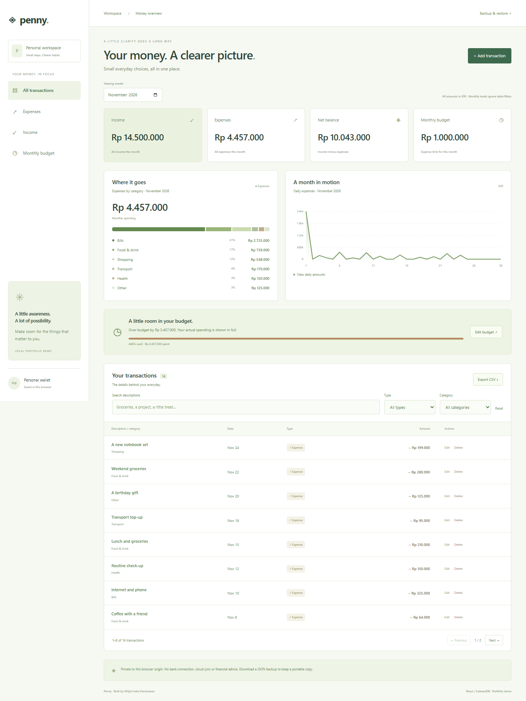

# Penny — React Expense Tracker

A browser-local expense tracker portfolio by **Afrijal Indra Hendrawan**. Track income and expenses, set a monthly budget, explore category/daily charts, and keep portable backups. Built with React, Vite and native IndexedDB.



## Run locally

Requires Node.js 22.12+ and npm.

```sh
npm ci
npm run dev
```

Open http://127.0.0.1:5179. On Windows use `npm.cmd` if PowerShell blocks scripts, or run `start-expense-tracker.bat` after setup.

For the production build:

```sh
npm run build
npm run preview
```

Production preview uses port 4179. Vite uses strict ports so a busy port is reported rather than silently opening a different workspace origin.

## Try the demo

Start with an empty workspace and click **Load sample data**. The sample creates 14 fictional transactions and a Rp 6,000,000 budget in the currently selected month. It can only initialize a completely empty workspace; it never mixes sample data with existing records.

Sample monthly totals: income **Rp 14,500,000**, expenses **Rp 4,457,000**, net balance **Rp 10,043,000**, budget remaining **Rp 1,543,000**. The browser test sets the budget to Rp 1,000,000 to exercise an over-budget state; screenshots show that scenario.

## Features

- Add, edit and confirm deletion of income/expense transactions.
- Fixed type-specific categories; switching type resets the category to a valid one.
- Monthly selection; type/category/description filters; pagination, newest date first.
- Income, expenses, net balance, monthly expense budget and over-budget feedback.
- Expense categories and daily expense chart, with a readable daily-values disclosure.
- Filtered CSV export, including all matching pages.
- Full JSON backup and validated, explicitly confirmed workspace replacement.
- Persistence across reloads; atomic writes and revision checks prevent stale tabs from overwriting newer data.
- Native modal dialogs, Escape-to-close, visible focus, loading/empty/error/recovery states and responsive layouts.

## Calculation rules

All amounts are **whole rupiah (IDR)**, stored as positive safe integers from 1 to 999,999,999. Decimal amounts, signs, exponent notation and thousands separators are rejected on input. Type determines income vs expense; users never enter negative amounts. This avoids floating-point monetary rounding for the supported currency.

The selected calendar month scopes all summaries and charts. Transaction type/category/search filters affect the table and CSV **only**, not the month's summary. Income = sum of income rows; expense = sum of expense rows; net balance = income − expense. Net balance is a monthly difference, not a connected bank/account balance or carried-forward opening balance.

Each month has one optional expense budget. Income does not change that limit. Remaining = budget − expenses. When negative, the over-budget amount is displayed in full; only the visual progress bar is capped at 100%. Dates, including future dates within a selected month, contribute to that month's totals; this is not a separate planned/posted ledger. Dates are calendar strings, not UTC timestamps, and the default month comes from the device's local calendar.

## Persistence and two-tab behavior

The IndexedDB database is `penny-expenses-v1`, with a versioned workspace document containing transactions, monthly budgets and a revision. Every mutation reads the current document and checks the expected revision inside one read-write transaction. An invalid change or stale revision aborts without applying changes.

Forms capture the revision when opened. A `BroadcastChannel` refreshes other open tabs where supported; the revision check protects data even when notifications are unavailable. A form opened before another tab's save must be closed and reopened before it can submit. Restore also uses the revision guard.

Unreadable/unsupported saved data is not replaced automatically. The app shows recovery options to retry loading or download the stored document. Storage errors are surfaced before the UI claims a successful save. The whole-document approach intentionally caps the demo at **5,000 transactions and 240 budget months**; it is not designed for a large ledger.

**Storage is per browser profile and exact origin.** `localhost`, `127.0.0.1`, port 5179 and port 4179 are separate workspaces. Clearing site data, browser eviction or private browsing can remove local data. Download JSON backups if you need a portable copy. The data is not encrypted and is not synced to a server.

## Export and restore

**CSV** includes date, description, type, category and positive amount for every row matching the current month/table filters, regardless of page. Cells are quoted, UTF-8 BOM is included, and formula-like text is apostrophe-prefixed for safer spreadsheet opening. CSV is a review export, not a restore format.

**JSON** includes every transaction and every budget month. Backups have `schemaVersion: 1`, `revision`, `transactions` and `budgets`. Restore validates the schema, record types, categories, actual calendar dates, integer amount bounds, IDs, duplicate IDs and budget keys before any write. Backup import is limited to 5 MB. The user must confirm replacement; restore never merges records. The current local revision advances independently of the imported revision.

Descriptions are trimmed, 2–100 characters, and reject control characters. IDs are 1–64 letters/digits/hyphens. Dates use valid YYYY-MM-DD with years 1000–9999. There is no automatic currency conversion or missing-value inference.

## Verify

```sh
npm test
npm run build
npx playwright install chromium
# In another terminal, run npm run dev; then:
npm run test:browser
```

Set `CHROME_PATH` to an installed Chrome executable if preferred. Set `BASE_URL=http://127.0.0.1:4179` when testing the production preview. Browser checks launch a new disposable browser context, so they do not modify your regular browser profile.

Tests cover money/calendar boundaries, month/budget calculations, filters, CSV protection, large backup round-trips, persistence, rollback, stale restore and simultaneous IndexedDB writes. The full browser workflow checks sample data, pagination, add/edit/delete, budget changes, filters/CSV, JSON restore, reload persistence and an actual conflict between two tabs. GitHub Actions runs tests, builds and checks the production UI with Chromium.

See [verification record](docs/TEST-RESULTS.md) and [mobile layout](docs/mobile.png).

## Structure and scope

`src/domain.js`: pure validation, calculations, filtering, CSV and sample data. `src/storage.js`: atomic IndexedDB operations and conflicts. `src/main.jsx`: React workflow, forms and charts. `src/style.css`: custom responsive UI. `src/*.test.js`: domain/storage regressions. `tests/browser.mjs`: end-to-end browser checks.

No login, bank/API connection, cloud account, automatic recurring transactions, multi-currency accounting or financial advice. This is a local personal tracking portfolio, not a banking application. All sample transactions are fictional. No analytics, external images, fonts or chart CDN are used.

The owner selected requirements; Codex assisted with design, implementation and verification. This is original portfolio work, not a paid client engagement. MIT licensed.
